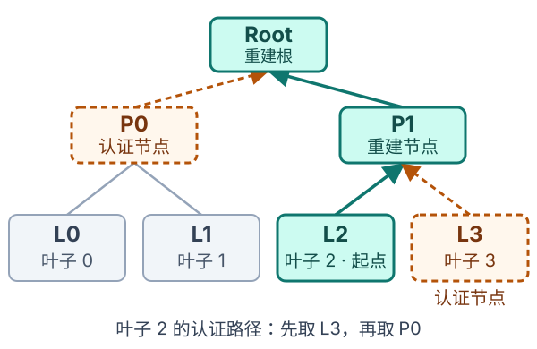

# 从一次性签名到多次签名：公钥压缩、Merkle 认证与 MSS

前面的 [Lamport](lamport.md)、[WOTS](WOTS.md) 和 [WOTS+](WOTS+.md) 已经回答了“如何用哈希完成一次签名”。这一篇进入第二阶段：**准备多把一次性密钥，让验证者用一个固定的可信根，验证这些密钥签署的不同消息。**

我们用一棵 4 个叶子的树，依次理解公钥压缩、Merkle 认证和 Merkle 签名方案（Merkle Signature Scheme，MSS）。读完后，应能说明一次签名需要携带什么、验证者如何计算根，以及签名者为什么必须记录密钥使用状态。

本文采用便于解释的教学构造：一次性签名沿用前篇的原论文 WOTS+，树使用通用哈希函数。它用于说明 MSS 的组合思想，不是 XMSS 或 LMS 的具体格式规范。图示、例子和演示均为本文的教学补充，来源见[参考资料](#references)。

阅读路线：[为什么需要树](#motivation) → [压缩一把公钥](#public-key-compression) → [构建四叶树](#merkle-tree) → [认证路径](#authentication-path) → [完整 MSS 流程](#mss-algorithms) → [状态与容量](#state-and-capacity)。

## 1. 准备很多把密钥，还缺少什么？ {#motivation}

WOTS+ 的一次性限制意味着：需要签署 4 条消息，就准备 4 把不同的一次性密钥，分别使用一次。

| 签名次数 | 使用的私钥 | 对应公钥 |
| --- | :---: | :---: |
| 第 1 次 | $SK_0$ | $PK_0$ |
| 第 2 次 | $SK_1$ | $PK_1$ |
| 第 3 次 | $SK_2$ | $PK_2$ |
| 第 4 次 | $SK_3$ | $PK_3$ |

这里的大写 $SK_i,PK_i$ 表示**整把一次性密钥**，索引 $i$ 从 0 开始。它们不是一条 WOTS+ 链的起点和终点。

如果验证者事先可信地保存了全部 4 把公钥，就可以直接使用它们。但密钥数量增加后，预先分发和保存全部公钥会变得笨重。

另一种做法是每次随签名附上公钥。它解决了“从哪里拿到公钥”，却没有回答“为什么相信这把公钥”：攻击者也能生成自己的密钥，用它签名，再把自己的公钥一起发来。

因此，我们希望做到：

- 验证者事先只保存一个短小、固定的可信根。
- 每次签名附上少量材料，证明本次一次性公钥确实属于这个根所绑定的集合。
- 每把一次性密钥仍然只使用一次。

## 2. 公钥压缩：先处理一把公钥内部的多个元素 {#public-key-compression}

### 2.1 一把 WOTS+ 公钥里有哪些东西？ {#public-key-parts}

前篇的原论文 WOTS+ 公钥包括公开函数密钥、公开掩码，以及各条链的终点。把索引为 $i$ 的公钥写成：

$$
U_i=(k_i,\mathbf r_i)
$$

$$
PK_i=(U_i,\mathbf p_i),\qquad
\mathbf p_i=(p_{i,1},\ldots,p_{i,\ell})
$$

| 组成部分 | 用途 |
| --- | --- |
| $k_i$ | 选定这把 WOTS+ 密钥使用的函数 |
| $\mathbf r_i$ | 同一把密钥的所有链共享的逐步掩码 |
| $\mathbf p_i$ | $\ell$ 条链的终点 |
| $U_i$ | 为简化记号，将公开函数密钥与掩码合在一起称为公开参数 |

外层的 $i$ 表示第几把一次性密钥，$p_{i,j}$ 中的 $j$ 表示这把密钥里的第几条链。**公钥压缩要绑定的是完整的验证材料，包括 $U_i$，不能只处理链终点后就忽略这些参数。**

### 2.2 “压缩”得到一个短代表值 {#compression-meaning}

先抽象地写：

$$
L_i=\operatorname{Compress}(PK_i)
$$

$L_i$ 是完整公钥的短代表值。后面会把它放在 Merkle 树的一个叶子位置，所以这里使用字母 $L$。

这类压缩不是压缩文件：**无法从 $L_i$ 解压回完整的 $PK_i$。** 它提供的是一个用于检查的哈希承诺。如果有人提供一把候选公钥 $PK'_i$，验证者可以重新压缩，并检查：

$$
\operatorname{Compress}(PK'_i)\stackrel{?}{=}L_i
$$

在合适的哈希安全假设下，攻击者难以用一把不同的公钥替换原公钥，却仍得到相同的代表值。

### 2.3 验证所需的公开参数不会消失 {#recover-public-key}

WOTS+ 有一个很有用的性质：给定消息输入、签名和公开参数，验证者可以沿每条链补算到终点，得到**候选公钥元素**。

因此，在本文的教学构造中：

1. 签名者随一次性签名提供 $U_i=(k_i,\mathbf r_i)$。
2. 验证者根据消息和 Checksum 确定各条链的签名位置。
3. 使用收到的 $U_i$，从签名值继续计算，恢复候选终点向量 $\mathbf p'_i$。
4. 组成候选公钥 $PK'_i=(U_i,\mathbf p'_i)$，再计算它的代表值。

收到的 $U_i$ 起初也不可信。只有后面根据它重建的叶子、认证路径和根全部吻合，验证者才接受这套验证材料。

这里节省的是预先分发、保存全部公钥的负担。所需的信息有的随签名提供，有的通过计算恢复，并没有凭空消失。

## 3. Merkle 树：把多把公钥绑定到一个根 {#merkle-tree}

### 3.1 先约定叶子与内部节点的计算方式 {#tree-hash}

本文使用一个输出为 $d$ bit 的通用哈希函数 $H$。它需要适合这里的哈希承诺用途；为理解这个教学构造，可以要求它具备抗碰撞性。它与 WOTS+ 链中的 $f_k$ 承担不同任务。

具体定义：

$$
L_i=H\!\left(\mathtt{0x00}\parallel
\operatorname{Encode}(PK_i)\right)
$$

$$
\operatorname{Node}(A,B)
=H(\mathtt{0x01}\parallel A\parallel B)
$$

其中：

- $\parallel$ 表示拼接。
- $\operatorname{Encode}$ 是事先约定、无歧义的完整公钥编码，字段顺序和长度必须确定。
- $\mathtt{0x00}$ 和 $\mathtt{0x01}$ 各表示一个字节，用来区分“压缩公钥”和“合并两个树节点”这两种用途。
- $A$ 始终是左孩子，$B$ 始终是右孩子，不能随意交换。

输出长度 $d$ 与前篇 WOTS+ 元素长度 $n$ 是不同角色的参数；本篇都以 bit 为单位。演示中使用 SHA-256，因此 $d=256$。

### 3.2 四个叶子怎样得到一个根？ {#four-leaf-tree}

先生成 4 把独立的一次性密钥，分别计算叶子 $L_0,L_1,L_2,L_3$。将相邻叶子两两合并：

$$
P_0=\operatorname{Node}(L_0,L_1)
$$

$$
P_1=\operatorname{Node}(L_2,L_3)
$$

再合并这两个节点：

$$
R=\operatorname{Node}(P_0,P_1)
$$

图中的 Root 就是根 $R$；图中也标出了下一节会使用的叶子 2 认证例子。

这棵树高度为 $h=2$，因为从叶子到根需要执行两层合并。它有 $2^h=4$ 个叶子，可以容纳 4 把一次性密钥。

注意两个不同层次：

| 层次 | 处理的对象 |
| --- | --- |
| 单个公钥的压缩 | 把一把 WOTS+ 公钥的公开参数和所有链终点变成一个叶子值 |
| 外层 Merkle 树 | 把很多把不同公钥的叶子值组合成一个根 |

一条 WOTS+ 链不是这棵树的一个叶子；**一整把 WOTS+ 公钥才对应一个叶子。**

## 4. 认证路径：只提供沿途缺少的兄弟节点 {#authentication-path}

### 4.1 从叶子 2 开始验证 {#leaf-two-example}

假设本次使用索引为 2 的一次性密钥，也就是第 3 把密钥。验证者从消息和签名恢复了候选公钥，并算出候选叶子 $L'_2$。

要计算它的父节点，还缺少右侧兄弟 $L_3$。算出父节点以后，要继续到根，还缺少左侧兄弟 $P_0$。因此，只需提供：

$$
\operatorname{Auth}_2=(L_3,P_0)
$$

认证路径按**从叶子向根**的顺序排列。验证者依次计算：

$$
P'_1=\operatorname{Node}(L'_2,L_3)
$$

$$
R'=\operatorname{Node}(P_0,P'_1)
$$

最后与事先信任的根比较：

$$
R'\stackrel{?}{=}R
$$

第一层当前节点在左边，所以先拼接 $L'_2$；第二层当前节点在右边，所以先拼接兄弟 $P_0$。这就是为什么认证路径必须配合叶子索引使用。

认证路径保存的是**兄弟节点的值**。当前路径上的父节点由验证者计算，不需要再发送；可信根也已经由验证者持有。

### 4.2 四个叶子的路径对照 {#path-table}

下表的每一步都保持左孩子在前、右孩子在后：

| 叶子索引 | 认证路径：从下到上 | 第一次合并 | 第二次合并 |
| :---: | :---: | --- | --- |
| 0 | $(L_1,P_1)$ | $\operatorname{Node}(L_0,L_1)=P_0$ | $\operatorname{Node}(P_0,P_1)=R$ |
| 1 | $(L_0,P_1)$ | $\operatorname{Node}(L_0,L_1)=P_0$ | $\operatorname{Node}(P_0,P_1)=R$ |
| 2 | $(L_3,P_0)$ | $\operatorname{Node}(L_2,L_3)=P_1$ | $\operatorname{Node}(P_0,P_1)=R$ |
| 3 | $(L_2,P_0)$ | $\operatorname{Node}(L_2,L_3)=P_1$ | $\operatorname{Node}(P_0,P_1)=R$ |

对于更高的树，也可以逐层判断方向：当前索引是偶数时，当前节点是左孩子；是奇数时，它是右孩子。每完成一层，就将索引除以 2 并向下取整，再判断上一层。

例如，索引 2 的过程是 $2\to1\to0$：先在左侧，再在右侧，最后到根。

### 4.3 交互演示：选择叶子，重建可信根 {#merkle-demo}

选择不同叶子，观察哪些节点由验证者计算、哪些兄弟节点需要随签名提供。再尝试修改认证路径中的第一个节点，比较重建结果与固定的可信根。

演示使用 4 个固定的“演示公钥”字符串和真实 SHA-256，展示认证路径的计算，不生成 WOTS+ 密钥或签名。界面只截取哈希值的前 8 个十六进制字符用于阅读，比较使用完整的 256 bit 值。切换叶子只是在查看认证路径，不会消耗一次性密钥。

没有 JavaScript 或浏览器不支持所需接口时，仍可使用上方静态树图、公式和路径对照表阅读这一节。

## 5. 组装 MSS：密钥生成、签名与验签 {#mss-algorithms}

现在把前面的组件连接起来。为承接 WOTS+，这里的 $M$ 指一次性签名直接处理的固定长度输入。实际应用如何从任意长度消息得到这个输入，需要由具体方案明确规定。

### 5.1 KeyGen：生成多把密钥，并建立一个根 {#keygen}

对于高度为 $h$ 的树：

1. 生成 $2^h$ 把不同的一次性密钥对 $(SK_i,PK_i)$。
2. 压缩每把完整公钥得到叶子，逐层构建 Merkle 树，得到根 $R$。
3. 签名者保存各把私钥、公开参数及取得认证路径所需的树信息，将下一把未使用密钥的索引初始化为 $q=0$。

验证者事先获得可信根，以及固定的算法和参数约定。下面将这些约定统称为 $\mathcal P$，包括树高、WOTS+ 参数、哈希函数和编码规则：

$$
PK_{\mathrm{MSS}}=(R,\mathcal P)
$$

验证者需要预先确定可信根 $R$ 以及对应的算法和参数 $\mathcal P$。若这些规则已由协议固定，公钥就可以只保存根值；验签时仍必须遵循这些规则。

### 5.2 Sign：用一把新密钥签名，附上认证材料 {#sign}

假设下一把未使用的密钥索引为 $q$：

1. 检查 $q<2^h$，原子地预留索引 $i=q$，并将下一索引持久化为 $q+1$。
2. 使用 $SK_i$ 对 $M$ 产生一次性签名 $\sigma_i$。
3. 取得这把公钥的公开参数 $U_i$ 和认证路径 $\operatorname{Auth}_i$。
4. 返回组合后的签名。

本文的教学签名写为：

$$
\Sigma=(i,\sigma_i,U_i,\operatorname{Auth}_i)
$$

| 部分 | 验证者用它做什么 |
| --- | --- |
| $i$ | 确定叶子位置和各层的左右拼接方向 |
| $\sigma_i$ | 根据消息恢复 WOTS+ 的候选链终点 |
| $U_i=(k_i,\mathbf r_i)$ | 提供恢复链终点所需的公开函数密钥和掩码 |
| $\operatorname{Auth}_i$ | 提供从叶子重建根所缺少的兄弟节点 |

这里显式携带 $U_i$，是为了与前篇原论文 WOTS+ 的公钥定义保持一致。后续具体方案可以采用不同的公开参数组织方式，不能直接套用这一教学签名格式。

### 5.3 Verify：从候选一次性公钥，一直检查到可信根 {#verify}

验证者收到 $M,\Sigma$，使用自己持有的 $PK_{\mathrm{MSS}}$：

1. **检查格式。** 索引满足 $0\le i<2^h$；路径恰好包含 $h$ 个 $d$ bit 节点；一次性签名和公开参数的长度符合固定规则。
2. **恢复候选终点。** 从 $M$ 重新计算消息数字和 Checksum，利用 $\sigma_i,U_i$ 补完各条链，得到 $\mathbf p'_i$。
3. **重建完整候选公钥。** 令 $PK'_i=(U_i,\mathbf p'_i)$，按固定编码计算候选叶子 $L'_i$。
4. **逐层计算根。** 结合索引 $i$ 和认证路径，保持正确的左右顺序，得到 $R'$。
5. **比较可信根。** 仅当 $R'=R$ 时接受。

不能因为收到的公开参数“格式正确”，就提前认为它们可信。**参数、恢复出的链终点和树路径共同参与根的计算，最后的根比较才把它们绑定到固定公钥上。**

以第 3 次签名为例，使用的是索引 2 的密钥。验证者收到：

$$
\Sigma=(2,\sigma_2,U_2,(L_3,P_0))
$$

先从 $M,\sigma_2,U_2$ 得到 $L'_2$，然后计算：

$$
R'=\operatorname{Node}\!\left(
P_0,\operatorname{Node}(L'_2,L_3)\right)
$$

这与第 4 节的认证过程完全一致。

## 6. 状态与容量：多次签名来自多把一次性密钥 {#state-and-capacity}

### 6.1 为什么 MSS 从这里开始就需要状态？ {#state}

在我们的 4 叶子示例中，签名者的状态依次变化：

| 当前下一索引 $q$ | 本次使用的密钥 | 为后续保存的索引 |
| :---: | :---: | :---: |
| 0 | $SK_0$ | 1 |
| 1 | $SK_1$ | 2 |
| 2 | $SK_2$ | 3 |
| 3 | $SK_3$ | 4 |
| 4 | 已耗尽，不能继续使用这棵树签名 | 4 |

这个状态用来防止同一把一次性私钥再次用于不同消息。**MSS 本身已经有状态要求，不是等到 XMSS 才出现状态管理。**

树在密钥生成时就确定了。使用一个叶子后，不需要把它从树上删除，也不需要重算根；变化的是签名者保存的使用状态，可信根保持不变。

验证者通过认证路径只能确定这把一次性公钥属于该树，不能仅凭这一次验签就知道它以前是否被使用过。因此，“路径验证通过”不代表密钥复用是安全的。

### 6.2 为什么只把索引放在内存里不够？ {#state-recovery}

如果输出签名后程序崩溃，却没有保存最新索引，下次启动就可能再次使用同一把密钥。

因此，前面的签名流程先预留并保存索引，再输出签名。若中途失败，宁可跳过一个叶子，也不能将已经预留、可能已经使用的密钥重新分配。

持久化还不等于防止回滚：恢复旧备份、旧快照，或者把同一份私钥复制给两个独立签名程序，都可能造成重复分配。实际方案需要同时处理状态更新、恢复和并发分配。[RFC 8554 的状态管理讨论](https://www.rfc-editor.org/rfc/rfc8554.html#section-9.2)说明了这类方案共同面对的问题。

### 6.3 树高决定一次性密钥的总数量 {#capacity}

对于每层都填满、所有叶子深度均为 $h$ 的二叉树，叶子数量为：

$$
N=2^h
$$

个叶子，也就最多支持 $2^h$ 次一次性密钥使用。预留后失败、跳过叶子等情况可能减少实际可输出的签名数量。

用完以后需要新的签名密钥和根公钥，并通过可信方式让验证者接受新根。把索引重新置零，或者只在旧叶子位置换一把新密钥，都不能延长原来这棵树的安全使用次数。

## 7. 代价：公钥固定，认证路径随树高增长 {#costs}

每层认证只需要一个兄弟节点。每个节点是 $d$ bit，因此：

$$
|\operatorname{Auth}_i|=h\,d\ \text{bit}
$$

当 $d=256$ 时，每个节点占 32 字节：

| 树高 $h$ | 一次性密钥数量 $2^h$ | 每份认证路径 | 根值大小 |
| :---: | ---: | ---: | ---: |
| 2 | 4 | 64 B | 32 B |
| 10 | 1,024 | 320 B | 32 B |
| 20 | 1,048,576 | 640 B | 32 B |

这张表只统计根和认证路径，尚未包含一次性签名、公开参数、索引与参数标识。它说明：树覆盖的公钥数量按指数增加，单份认证路径的长度按树高线性增加。

对于本文显式携带原论文 WOTS+ 公开参数的构造，各部分长度为：

| 部分 | 长度 |
| --- | --- |
| WOTS+ 签名 $\sigma_i$ | $\ell n$ bit |
| 公开参数 $U_i$ | $(w-1)n+\lvert k_i\rvert$ bit |
| 认证路径 | $hd$ bit |
| 索引 | $b_{\mathrm{idx}}$ bit，取决于具体编码 |

这里 $|k_i|$ 是函数密钥的 bit 长度，$b_{\mathrm{idx}}$ 是实际索引编码长度。理想紧凑编码需要 $h$ bit，按字节序列化时可能需要填充。忽略其他格式开销时：

$$
|\Sigma|
=\ell n+(w-1)n+|k_i|+hd+b_{\mathrm{idx}}
$$

因此，不能只把“一次性签名大小加上认证路径”当作本文完整签名大小。参数改成公开派生以后，格式和成本也会随之改变，这将在具体方案中讨论。

密钥生成也有代价：最直接的方法需要计算所有叶子和内部节点。树更高，密钥准备和认证路径管理的成本也会上升。如何生成、缓存和更新路径，是后续 XMSS 等方案中的重要问题。

## 8. 认证解决了什么，以及如何进入 XMSS {#next}

到这里，两个层次可以分清：

| 组件 | 负责的事情 |
| --- | --- |
| WOTS+ | 通过一次性签名，把消息与一把一次性公钥关联起来 |
| 公钥压缩与 Merkle 认证 | 把本次一次性公钥关联到固定的根 |
| 签名者的状态管理 | 防止一次性密钥重复分配 |
| 外层公钥分发或协议 | 决定验证者为什么信任这个根属于某个签名者 |

根比较成功说明当前验证材料与可信根一致，不能替代“根公钥属于谁”的信任建立，也不自动判断消息是否过期或被重放。

从安全直觉看，攻击者要伪造，就需要攻破某个一次性签名，或让被替换的公钥、树节点仍然得到相同的哈希承诺。这里只解释组合关系，不展开完整安全归约。尤其不能因为前篇 WOTS+ 的链函数使用较弱的安全假设，就直接认定本文额外加入的通用哈希 $H$ 也不需要抗碰撞性。

下一阶段进入 **XMSS**：在已经理解 MSS 思想后，再学习它怎样组织 WOTS+、压缩公钥、计算树节点、处理消息和维护状态。此时引入 L-tree、公开种子和地址字段，就能看清每个细节在完整方案中承担什么任务。

再往后学习 $\mathrm{XMSS}^{\mathrm{MT}}$，讨论上层树如何认证下层树的根。多层组织仍然需要状态；无状态动机和 FORS 则放到第四阶段。

## 9. 参考资料 {#references}

- [Ralph Merkle：A Certified Digital Signature](https://www.ralphmerkle.com/papers/Certified1979.pdf)：第 6 节讨论树认证，适合理解认证路径的起点。
- [W-OTS+ — Shorter Signatures for Hash-Based Signature Schemes](https://eprint.iacr.org/2017/965)：第 2.2 节定义前篇沿用的一次性签名、公钥和公开参数。
- [RFC 6962 §2.1 — Merkle Hash Trees](https://www.rfc-editor.org/rfc/rfc6962.html#section-2.1)：叶子与内部节点使用不同前缀的哈希树实例。本文借用这种用途区分方式，不采用其日志协议。
- [RFC 8554 §5.4 — LMS Signature Generation and Verification](https://www.rfc-editor.org/rfc/rfc8554.html#section-5.4)：从一次性签名恢复候选公钥并重建根的具体实例；LMS 使用 LM-OTS，与本文教学格式不同。
- [RFC 8554 §9.2 — Reuse of One-Time Signature Keys](https://www.rfc-editor.org/rfc/rfc8554.html#section-9.2)：状态、备份恢复与一次性密钥复用问题。
- [RFC 8391 §4.1 — XMSS](https://www.rfc-editor.org/rfc/rfc8391.html#section-4.1)：下一阶段的具体方案，结合 WOTS+、公钥压缩、树认证和索引管理。
